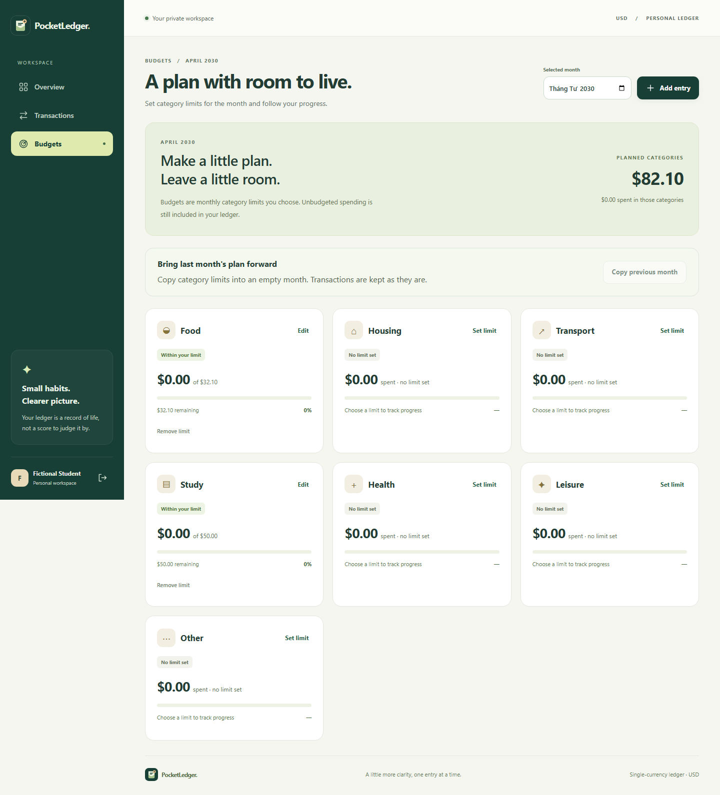
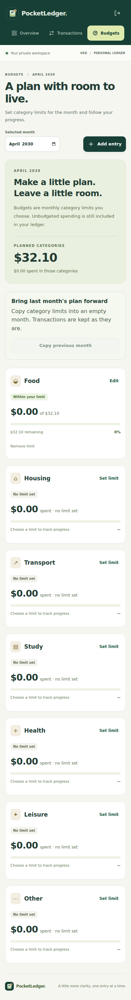
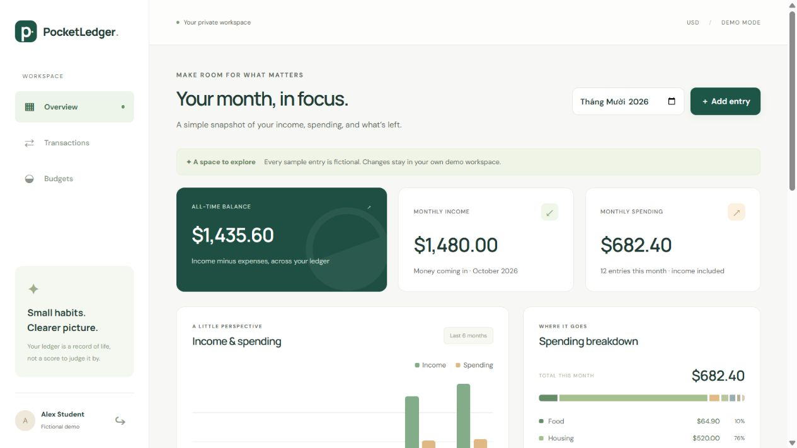
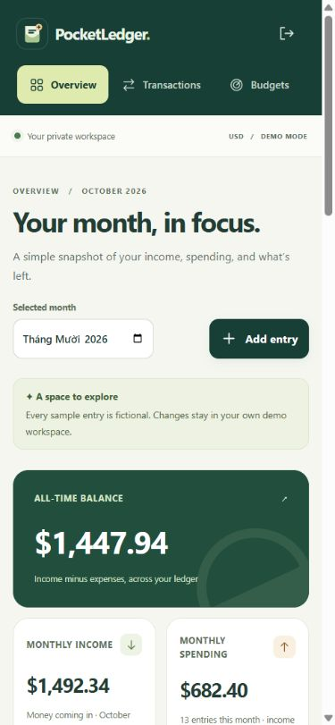

# PocketLedger

**Live demo:** [Mở PocketLedger](https://giang-pocketledger.onrender.com). Bản Render Free dùng dữ liệu SQLite tạm; dữ liệu có thể mất sau khi host ngủ hoặc redeploy. Xem [cấu hình hosting](docs/render-free.md).


Ứng dụng ghi chép thu chi và theo dõi ngân sách cá nhân, dùng React, TypeScript,
Express và SQLite.

Điểm kỹ thuật: tính tiền bằng cent nguyên, truy vấn theo chủ sở hữu và sao chép
ngân sách trong transaction. [Kết quả kiểm chứng 03/11/2026](docs/portfolio-verification.md)
ghi rõ kiểm thử local, ảnh mới và phạm vi kiểm tra hosting.

## Chức năng

- Thêm, sửa, xóa khoản thu và chi.
- Lọc giao dịch theo tháng và danh mục.
- Đặt ngân sách theo danh mục, xem tiến độ chi và khoản vượt mức.
- Sao chép hạn mức tháng trước vào tháng đang trống, giữ nguyên giao dịch và các tháng cũ.
- Xem số dư, tổng thu chi trong tháng và biểu đồ sáu tháng.
- Xuất các giao dịch đã lọc ra CSV.
- Đăng ký tài khoản hoặc dùng thử với dữ liệu mẫu riêng.

Bản hiện tại dùng USD. Số tiền được lưu dưới dạng số nguyên cent để tính toán chính xác;
giá trị gửi lên API là chuỗi thập phân, ví dụ `"12.50"`.

## Chạy ở máy cá nhân

Cần Node.js 24 trở lên.

```bash
npm ci
npm run dev
```

Mở http://127.0.0.1:5174. Vite chuyển `/api` đến backend ở cổng 3002.
Có thể sao chép `.env.example` thành `.env` để thay cấu hình.
Trên PowerShell: `Copy-Item .env.example .env`.

Chọn **Explore a private demo** để tạo không gian dùng thử với dữ liệu hư cấu,
hoặc đăng ký tài khoản để bắt đầu với sổ trống.
Dữ liệu mẫu chỉ được thêm khi tài khoản chưa có giao dịch và ngân sách.

### Tài khoản demo cấu hình qua môi trường

Trong môi trường demo riêng, đặt `DEMO_LOGIN_ENABLED=1` và trỏ `DATABASE_PATH` đến
database dành riêng cho demo. Cấp `DEMO_LOGIN_EMAIL` và `DEMO_LOGIN_PASSWORD` qua biến
môi trường hoặc kho bí mật của host. Mật khẩu cần dài 10–128 ký tự. Khởi động ứng dụng rồi
đăng nhập bằng biểu mẫu thông thường để xem giao dịch và ngân sách hư cấu.

Ứng dụng chỉ khởi tạo một lần và từ chối dùng email đã thuộc tài khoản đăng ký.
Tài khoản demo chỉ truy cập sổ của chính nó. Chỉ nhập dữ liệu hư cấu vì người dùng
chung tài khoản sẽ thấy cùng một workspace.

## Kiểm tra và build

```bash
npm test
npm run build
```

Để chạy bản build cục bộ, đặt `APP_ORIGIN=http://127.0.0.1:3002` trong `.env` rồi chạy:

```bash
npm start
```

Khi đưa lên host, cấu hình `NODE_ENV=production`, HTTPS, `COOKIE_SECURE=true`
và `DATABASE_PATH` trên ổ lưu trữ cố định. Bản này chạy một tiến trình Node.

## Cấu trúc

- `src/main.tsx`: màn hình tổng quan, giao dịch và ngân sách.
- `server/domain.ts`: quy tắc tiền, ngày và xuất CSV.
- `server/store.ts`: truy vấn SQLite, lược đồ và dữ liệu mẫu.
- `server/app.ts`: API, đăng nhập, kiểm tra quyền và xử lý lỗi.
- `server/*.test.ts`: kiểm thử hành vi của API và dữ liệu.

Mỗi truy vấn được giới hạn theo tài khoản đăng nhập.
Mật khẩu dùng scrypt; phiên đăng nhập dùng cookie HttpOnly; thao tác ghi cần CSRF token.
CSV áp dụng cùng bộ lọc với danh sách và xử lý các ô có thể bị phần mềm bảng tính hiểu là công thức.

## Giới hạn hiện tại

Ứng dụng chưa kết nối ngân hàng, chuyển đổi tiền tệ hoặc tạo giao dịch định kỳ.
Mỗi tài khoản có tối đa 10.000 giao dịch. Danh sách tải 50 kết quả mỗi lần;
nút **Load older entries** cho phép xem tiếp toàn bộ kết quả phù hợp, kể cả sau 500 giao dịch.
Đổi tháng hoặc danh mục sẽ tải lại từ đầu. Lỗi tải trang tiếp theo giữ nguyên các hàng đã xem để thử lại.
Đây là danh sách dữ liệu hiện tại, chưa phải bản chụp lịch sử; dùng **Refresh list** khi cần tải lại
sau khi sửa ở tab khác. CSV xuất toàn bộ kết quả phù hợp.

Trong **Budgets**, chọn tháng chưa có hạn mức rồi bấm **Copy previous month**.
Thao tác sao chép cả nhóm hạn mức trong một transaction, không ghi đè tháng đã có kế hoạch.
Nếu phản hồi bị mất, ứng dụng tải lại dữ liệu để nhận biết bản sao đã được lưu.

## Docker và kiểm thử trình duyệt

```bash
docker compose up --build -d
```

Mở http://127.0.0.1:3002. Compose này dành cho máy cá nhân, chỉ mở cổng trên loopback;
volume `pocketledger-data` giữ dữ liệu khi khởi động lại. Docker image chạy bằng tài khoản `node`,
có healthcheck kiểm tra SQLite. Khi đưa lên host thật, cấu hình HTTPS theo [hướng dẫn triển khai](docs/deployment.md).

```bash
npm run build
npx playwright install chromium
npm run test:browser
```

[GitHub Actions](https://github.com/nguyenhonggiang2407/PocketLedger/actions/workflows/ci.yml)
chạy kiểm thử API, build, giao diện, Docker và dữ liệu sau khi khởi động lại container.
Các bài kiểm tra trình duyệt gồm tải hơn 500 giao dịch, lỗi mạng, phản hồi trang cũ đến muộn,
sao chép ngân sách khi mất phản hồi, phiên hết hạn và màn hình điện thoại.
Ảnh mới được lưu trong artifact `pocketledger-screenshots` của lần chạy.

Xem [cách dùng thử](docs/demo.md).

## Kế hoạch ngân sách



<details>
<summary>Ngân sách trên điện thoại</summary>



</details>

Bản nâng cấp vượt qua **19 kiểm thử API/logic và 5 kiểm thử trình duyệt**, cùng Docker và
kiểm tra dữ liệu sau khi khởi động lại container. [Xem lần kiểm tra](https://github.com/nguyenhonggiang2407/PocketLedger/actions/runs/41574358655).

## Hình ảnh





## Giấy phép

Mã ứng dụng và logo dùng [MIT License](LICENSE). Các thư viện giữ giấy phép riêng.
